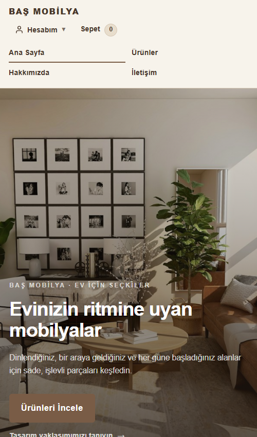
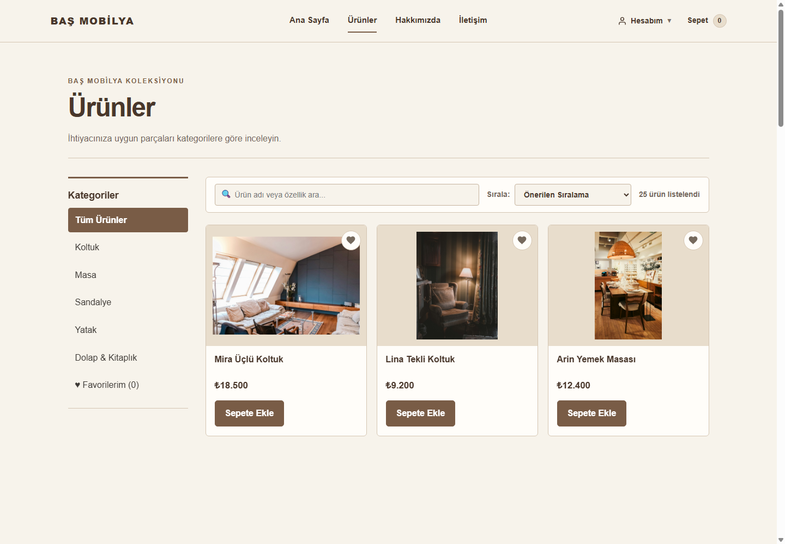
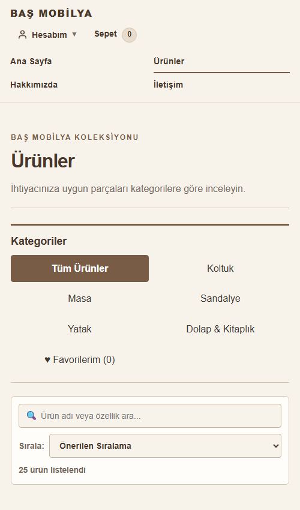

# BAŞ MOBİLYA — Web Programlama Dönem Sonu Projesi

**Canlı Site:** [https://wqardaa0.github.io/web-programlama-projesi/](https://wqardaa0.github.io/web-programlama-projesi/)  
**Ders:** MBLP213 Web Programlama (2026–2027 Güz) · **Öğrenci:** Arda Baş (251030054)

BAŞ MOBİLYA; kullanıcıların günlük yaşam alanları için sade ve işlevsel mobilyaları inceleyebileceği, kategorilere göre filtreleyip arayabileceği, favorilere ekleyebileceği ve demo sipariş akışını deneyimleyebileceği çok sayfalı, mobil uyumlu bir mobilya mağazası web uygulamasıdır.

---

## Öne Çıkan Özellikler

- **Semantik ve Çok Sayfalı Yapı:** Ortak üst menü (`site-header`), açılır hesap menüsü (`Hesabım ▼`) ve alt bilgi (`site-footer`) ile birbirine bağlı 10 HTML sayfası.
- **Katalog, Arama ve Sıralama:** 25 ürünlük katalogda kategori filtresi, anlık metin arama, fiyat/isim sıralaması ve `<dialog>` ile ürün detay penceresi.
- **Sepet ve Favoriler (`localStorage`):** Sayfa yenilense bile korunan sepet adet yönetimi, favori listesi ve bildirim (toast) sistemi.
- **Açık / Koyu Tema Desteği:** CSS değişkenleri (`:root[data-theme="dark"]`) ile tüm sayfalarda çalışan karanlık mod.
- **Form Doğrulama:** Giriş, kayıt, iletişim, profil/şifre ve teslimat/ödeme formlarında boş veya hatalı girişlerde anlık kullanıcı uyarısı.
- **Responsive Tasarım:** Masaüstü, tablet ve mobil ekranlarda (`@media` kırılımları ile) taşma olmadan çalışan düzen.

---

## Ekran Görüntüleri

| Masaüstü (Ana Sayfa) | Mobil (Ana Sayfa) |
|---|---|
|  |  |

| Masaüstü (Ürünler) | Mobil (Ürünler) |
|---|---|
|  |  |

---

## Klasör ve Dosya Yapısı

```text
projem/
├── index.html          # Ana sayfa (hero, kategori kartları, öne çıkanlar, 3 adım)
├── urunler.html        # 25 ürünlük katalog, kategori filtresi, arama ve sıralama
├── sepet.html          # Sepet listesi, adet kontrolü ve sipariş özeti
├── odeme.html          # Teslimat formu ve doğrulamalı demo ödeme ekranı
├── siparis.html        # Tamamlanan demo sipariş özeti ve onay ekranı
├── hakkimizda.html     # Marka yaklaşımı ve tasarım anlayışı
├── iletisim.html       # Doğrulamalı iletişim formu
├── giris.html          # Üye giriş ekranı
├── kayit.html          # Yeni üyelik kayıt ekranı
├── ayarlar.html        # Hesap, profil bilgileri, adres, bildirim ve koyu tema ayarları
├── favicon.svg         # Site sekme ikonu
├── css/
│   ├── ortak.css       # Tema renkleri, karanlık mod, ortak header/footer, toast ve butonlar
│   ├── index.css       # Ana sayfa düzeni
│   ├── urunler.css     # Katalog, filtre ve arama/sıralama çubuğu stilleri
│   ├── sepet.css       # Sepet satırları ve özet paneli
│   ├── odeme.css       # Teslimat ve ödeme adımı stilleri
│   ├── siparis-onay.css# Sipariş onay kartı stilleri
│   ├── hakkimizda.css  # Hakkımızda sayfası düzeni
│   ├── iletisim.css    # İletişim sayfası düzeni
│   ├── giris.css       # Giriş formu düzeni
│   ├── kayit.css       # Kayıt formu düzeni
│   └── ayarlar.css     # Profil ve ayarlar sayfası düzeni
├── js/
│   └── script.js       # Ürün verisi, filtreleme, arama, sepet, favori, tema ve form doğrulama
├── images/             # 25 ürün ve yaşam alanı görseli
└── screenshots/        # Masaüstü ve mobil ekran görüntüleri
```

---

## Kullanılan Teknolojiler

- **HTML5:** Semantik sayfa yapısı (`<header>`, `<nav>`, `<main>`, `<section>`, `<article>`, `<footer>`, `<dialog>`)
- **CSS3:** Ortak değişkenler, açık/koyu tema, Flexbox, CSS Grid ve responsive `@media` sorguları
- **JavaScript (ES6+):** Dizi/nesne tabanlı ürün yönetimi, DOM manipülasyonu, `click`/`input`/`submit` olayları, form doğrulama ve `localStorage`
- **Git & GitHub Pages:** Sürüm kontrolü ve canlı yayın (`main` dalı / root)

---

## Geliştirme Süreci (Karşılaşılan Sorunlar ve Çözümler)

- **Ne yapmak istedim?** Harici bir kütüphane (Bootstrap vb.) kullanmadan, kendi renk paletine sahip tutarlı ve gerçekçi bir mobilya e-ticaret arayüzü kurmak.
- **Hangi zorluklarla karşılaştım?**
  1. Koyu modda ana sayfa alt bannerı (`home-note`) ve profil sayfasındaki rozetlerde arka plan/yazı kontrastı düşüyordu.
  2. Dar mobil ekranlarda (`600px` ve `800px` altı) açılır hesap menüsü sola taşıyor, katalog arama kutusu sıkışıyor ve sepet satırları yatay taşmaya yol açıyordu.
- **Nasıl çözdüm?**
  1. `:root[data-theme="dark"]` altında özel arka plan ve buton değişkenleri tanımlanarak kontrast düzeltildi.
  2. `css/ortak.css`, `css/urunler.css` ve `css/sepet.css` içindeki medya sorgularında `min-width: 0`, `flex: 1 1 100%`, `left: 0; right: auto` ve `overflow-x: hidden` düzenlemeleri yapılarak mobil görünüm taşmasız hale getirildi.

---

## Yerelde Çalıştırma

1. Proje klasörünü **Visual Studio Code** ile açın.
2. **Live Server** eklentisiyle kökteki `index.html` dosyasını başlatın.
3. Ek kurulum veya sunucu paketi gerektirmez.

---

## Demo Kapsamı ve Kaynakça

- **Demo Kapsamı:** Bu proje eğitim amaçlı bir ön yüz uygulamasıdır. Üyelik, iletişim ve ödeme formları gerçek sunucu veya banka işlemi gerçekleştirmez; kart bilgileri tarayıcıda saklanmaz.
- **Kaynakça ve Etik Bildirim:** Dokümantasyon için MDN Web Docs kaynaklarından yararlanılmıştır. Ürün görselleri eğitim amaçlı yerel `images/` klasöründe tutulmuş örnek fotoğraflardır. Kod düzenleme, hata ayıklama ve dokümantasyon aşamalarında yapay zekâ desteği kullanılmış, tüm kodlar incelenerek projeye uyarlanmıştır.
