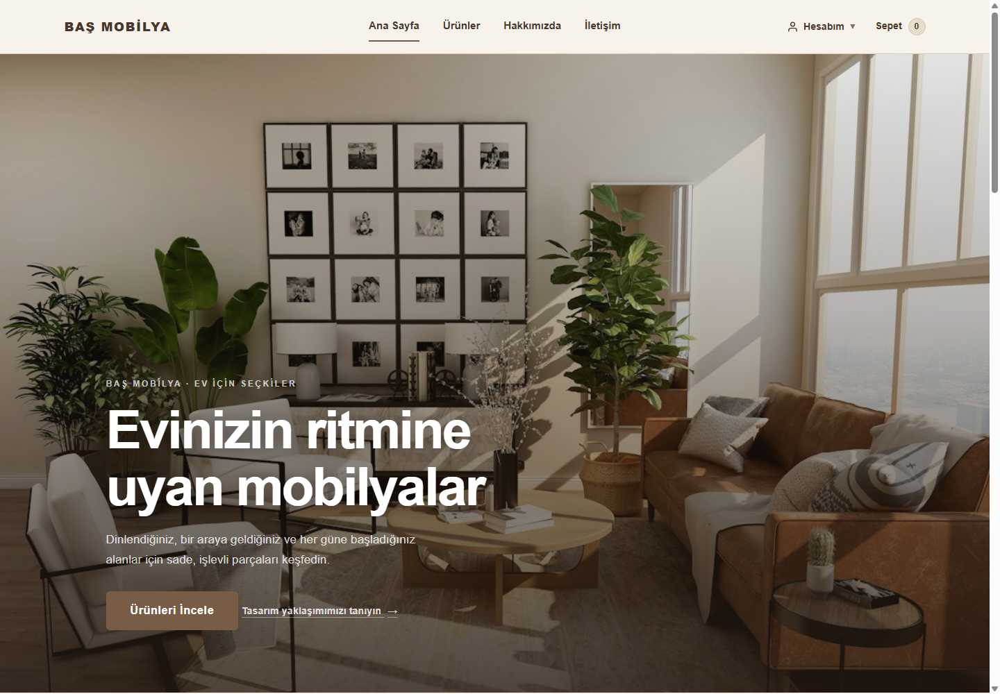

# BAŞ MOBİLYA — Web Programlama Projesi

BAŞ MOBİLYA, temel HTML, CSS ve JavaScript ile hazırlanmış mobilya mağazası arayüzü projesidir. Ürünleri inceleme, kategorilere göre filtreleme, favorilere ekleme, sepet oluşturma ve örnek sipariş akışını deneme özellikleri bulunur.

## Ekran görüntüleri

### Ana sayfa

### Ürün kataloğu

## Kullanılan teknolojiler

- HTML5: sayfa yapısı ve semantik içerik
- CSS3: ortak ve sayfaya özel stiller, Grid/Flexbox ve medya sorguları
- JavaScript: ürün filtreleme, arama/sıralama, favoriler, sepet ve form kontrolleri
- `localStorage`: demo sepeti, tema ve bazı arayüz tercihlerinin tarayıcıda saklanması

## Sayfalar

- `index.html` — Ana sayfa
- `urunler.html` — Ürün kataloğu
- `hakkimizda.html` — Marka ve tasarım yaklaşımı
- `iletisim.html` — İletişim formu
- `sepet.html` — Sepet ve sipariş özeti
- `odeme.html` — Teslimat ve demo ödeme adımı
- `siparis.html` — Sipariş onayı görünümü
- `giris.html`, `kayit.html`, `ayarlar.html` — Hesap arayüzü ve tercihler

Her HTML sayfası önce `css/ortak.css`, sonra kendi sayfasına ait CSS dosyasını kullanır. JavaScript `js/script.js` dosyasındadır; ürün fotoğrafları `images/` klasöründe bulunur.

## Yerelde çalıştırma

1. Proje klasörünü Visual Studio Code ile açın.
2. Live Server eklentisiyle kökteki `index.html` dosyasını başlatın.
3. Sayfalar arasında üst menü ve footer bağlantılarıyla gezinin.

Ek sunucu veya paket kurulumu gerekmez. GitHub Pages dağıtımı için `.github/workflows/deploy.yml` iş akışı eklenmiştir. Depo ayarlarında **Settings → Pages → Build and deployment → Source → GitHub Actions** seçildikten sonra `main` dalına gönderilen değişiklikler yayımlanabilir.

## Demo kapsamı

Bu proje eğitim amaçlı bir arayüz demosudur. Kayıt ve giriş gerçek hesap doğrulaması yapmaz; iletişim formu gerçek e-posta göndermez; ödeme formu banka tahsilatı yapmaz. Kart bilgileri tarayıcıda saklanmaz. Bu uygulama için sunucu veya ödeme altyapısı kullanılmamıştır.
